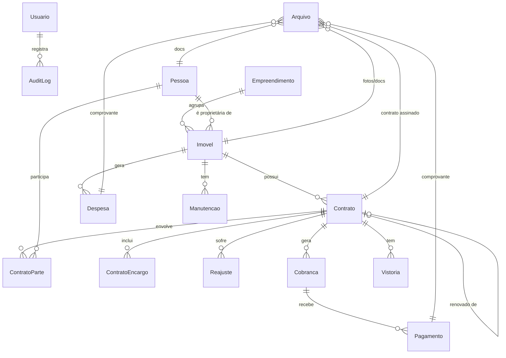

# 4. Modelo de dados

## 4.1 Diagrama de entidades



## 4.2 Entidades

| Entidade | Descrição |
|----------|-----------|
| **Usuario** | Quem acessa o sistema (admin ou operador) |
| **Empreendimento** | Prédio ou condomínio que agrupa várias unidades (ex.: um prédio de kitnets) |
| **Imovel** | Unidade alugável (casa, apto, kitnet...). Pode pertencer ou não a um empreendimento |
| **Pessoa** | Inquilino, fiador ou proprietário, PF ou PJ. Os papéis são definidos pelo vínculo |
| **Contrato** | Locação de um imóvel por um período |
| **ContratoParte** | Liga pessoas ao contrato com um papel (`LOCATARIO`, `FIADOR`) |
| **ContratoEncargo** | Valores fixos cobrados junto com o aluguel (condomínio, IPTU, água...) |
| **Reajuste** | Histórico de reajustes aplicados ao contrato |
| **Cobranca** | Parcela mensal (competência) do contrato |
| **Pagamento** | Recebimento (total ou parcial) de uma cobrança; estornos são valores negativos |
| **Despesa** | Gasto vinculado a um imóvel |
| **Manutencao** | Chamado de manutenção de um imóvel |
| **Vistoria** | Vistoria de entrada ou saída de um contrato |
| **Arquivo** | Tabela única para fotos e documentos, com relação polimórfica via FKs opcionais |
| **ModeloContrato** | Template de texto com variáveis |
| **Configuracao** | Chave/valor para dados do locador e parâmetros padrão |
| **AuditLog** | Trilha de alterações |

## 4.3 Rascunho do `schema.prisma`

> Este é o ponto de partida. Os campos podem mudar depois da reunião de validação (ver [dúvidas](01-visao-geral.md#dúvidas-para-validar-com-o-rafael)).

```prisma
generator client {
  provider = "prisma-client-js"
}

datasource db {
  provider = "postgresql"
  url      = env("DATABASE_URL")
}

// ───────────────────────── Usuários ─────────────────────────

enum Perfil {
  ADMIN
  OPERADOR
}

model Usuario {
  id          String     @id @default(cuid())
  nome        String
  email       String     @unique
  senhaHash   String
  perfil      Perfil     @default(OPERADOR)
  ativo       Boolean    @default(true)
  ultimoLogin DateTime?
  criadoEm    DateTime   @default(now())
  atualizadoEm DateTime  @updatedAt
  auditLogs   AuditLog[]
}

// ───────────────────────── Imóveis ─────────────────────────

enum TipoImovel {
  CASA
  APARTAMENTO
  KITNET
  SALA_COMERCIAL
  GALPAO
  TERRENO
  OUTRO
}

enum StatusImovel {
  DISPONIVEL
  ALUGADO
  RESERVADO
  EM_REFORMA
  INATIVO
}

enum Mobilia {
  NAO
  SEMI
  SIM
}

model Empreendimento {
  id          String   @id @default(cuid())
  nome        String
  cep         String?
  logradouro  String?
  numero      String?
  bairro      String?
  cidade      String   @default("Barretos")
  uf          String   @default("SP")
  observacoes String?
  imoveis     Imovel[]
  criadoEm    DateTime @default(now())
  atualizadoEm DateTime @updatedAt
}

model Imovel {
  id               String          @id @default(cuid())
  codigo           String          @unique            // ex.: "ADM-02", "CASA-07"
  tipo             TipoImovel
  status           StatusImovel    @default(DISPONIVEL)
  titulo           String                             // ex.: "Apto 02 – Ed. ADM"
  descricao        String?

  empreendimentoId String?
  empreendimento   Empreendimento? @relation(fields: [empreendimentoId], references: [id])
  proprietarioId   String?
  proprietario     Pessoa?         @relation("ProprietarioImovel", fields: [proprietarioId], references: [id])

  // Endereço (se tiver empreendimento, pode herdar dele)
  cep              String?
  logradouro       String?
  numero           String?
  complemento      String?                            // "Apto 02", "Fundos"
  bairro           String?
  cidade           String          @default("Barretos")
  uf               String          @default("SP")

  // Características
  quartos          Int             @default(0)
  suites           Int             @default(0)
  banheiros        Int             @default(0)
  vagas            Int             @default(0)
  areaM2           Decimal?        @db.Decimal(8, 2)
  mobilia          Mobilia         @default(NAO)
  aceitaPet        Boolean         @default(false)
  caracteristicas  String[]                           // ["ar-condicionado", "fechadura digital", ...]

  // Valores de referência
  valorAluguel     Decimal?        @db.Decimal(12, 2)
  valorCondominio  Decimal?        @db.Decimal(12, 2)
  valorIptuAnual   Decimal?        @db.Decimal(12, 2)

  // Dados legais / concessionárias
  matricula        String?
  inscricaoIptu    String?
  instalacaoAgua   String?
  instalacaoEnergia String?

  arquivos         Arquivo[]
  contratos        Contrato[]
  despesas         Despesa[]
  manutencoes      Manutencao[]

  deletadoEm       DateTime?
  criadoEm         DateTime        @default(now())
  atualizadoEm     DateTime        @updatedAt

  @@index([status])
  @@index([tipo])
  @@index([cidade, bairro])
}

// ───────────────────────── Pessoas ─────────────────────────

enum TipoPessoa {
  PF
  PJ
}

model Pessoa {
  id              String     @id @default(cuid())
  tipo            TipoPessoa @default(PF)
  nome            String                  // nome completo ou razão social
  nomeFantasia    String?
  documento       String     @unique      // CPF ou CNPJ, só dígitos
  rg              String?
  orgaoEmissor    String?
  dataNascimento  DateTime?  @db.Date
  estadoCivil     String?
  profissao       String?
  rendaMensal     Decimal?   @db.Decimal(12, 2)
  nacionalidade   String?    @default("brasileira")

  email           String?
  telefone1       String?
  telefone1Whats  Boolean    @default(true)
  telefone2       String?

  cep             String?
  logradouro      String?
  numero          String?
  complemento     String?
  bairro          String?
  cidade          String?
  uf              String?

  conjugeNome     String?
  conjugeDocumento String?
  observacoes     String?

  arquivos        Arquivo[]
  contratos       ContratoParte[]
  imoveis         Imovel[]   @relation("ProprietarioImovel")

  deletadoEm      DateTime?
  criadoEm        DateTime   @default(now())
  atualizadoEm    DateTime   @updatedAt

  @@index([nome])
}

// ───────────────────────── Contratos ─────────────────────────

enum StatusContrato {
  RASCUNHO
  ATIVO
  ENCERRADO
  RESCINDIDO
  RENOVADO
}

enum TipoGarantia {
  SEM_GARANTIA
  FIADOR
  CAUCAO
  SEGURO_FIANCA
  TITULO_CAPITALIZACAO
}

enum IndiceReajuste {
  IGPM
  IPCA
  INPC
  IVAR
  FIXO
  NENHUM
}

enum Finalidade {
  RESIDENCIAL
  COMERCIAL
}

enum PapelContrato {
  LOCATARIO
  FIADOR
}

model Contrato {
  id                String          @id @default(cuid())
  numero            Int             @unique @default(autoincrement())
  status            StatusContrato  @default(RASCUNHO)
  finalidade        Finalidade      @default(RESIDENCIAL)

  imovelId          String
  imovel            Imovel          @relation(fields: [imovelId], references: [id])

  dataInicio        DateTime        @db.Date
  prazoMeses        Int             @default(30)
  dataFim           DateTime        @db.Date
  valorAluguel      Decimal         @db.Decimal(12, 2)   // valor vigente (após reajustes)
  valorInicial      Decimal         @db.Decimal(12, 2)
  diaVencimento     Int             @default(10)
  aluguelAntecipado Boolean         @default(false)      // false = paga o mês vencido

  indiceReajuste    IndiceReajuste  @default(IGPM)
  percMulta         Decimal         @db.Decimal(5, 2) @default(10)
  percJurosMes      Decimal         @db.Decimal(5, 2) @default(1)
  multaRescisoriaMeses Int          @default(3)          // multa = N aluguéis, proporcional

  garantia          TipoGarantia    @default(SEM_GARANTIA)
  caucaoValor       Decimal?        @db.Decimal(12, 2)
  seguradora        String?
  apolice           String?
  garantiaObs       String?

  dataEncerramento  DateTime?       @db.Date
  motivoEncerramento String?
  valorMultaRescisoria Decimal?     @db.Decimal(12, 2)

  contratoAnteriorId String?        @unique
  contratoAnterior  Contrato?       @relation("Renovacao", fields: [contratoAnteriorId], references: [id])
  renovacao         Contrato?       @relation("Renovacao")

  modeloId          String?
  modelo            ModeloContrato? @relation(fields: [modeloId], references: [id])
  observacoes       String?

  partes            ContratoParte[]
  encargos          ContratoEncargo[]
  reajustes         Reajuste[]
  cobrancas         Cobranca[]
  vistorias         Vistoria[]
  arquivos          Arquivo[]

  criadoEm          DateTime        @default(now())
  atualizadoEm      DateTime        @updatedAt

  @@index([status])
  @@index([imovelId])
  @@index([dataFim])
}
// RN-01 (um ATIVO por imóvel) → índice parcial via migration SQL:
// CREATE UNIQUE INDEX contrato_um_ativo_por_imovel ON "Contrato"("imovelId") WHERE status = 'ATIVO';

model ContratoParte {
  id         String        @id @default(cuid())
  contratoId String
  contrato   Contrato      @relation(fields: [contratoId], references: [id], onDelete: Cascade)
  pessoaId   String
  pessoa     Pessoa        @relation(fields: [pessoaId], references: [id])
  papel      PapelContrato
  principal  Boolean       @default(false)   // locatário principal (nome no recibo)

  @@unique([contratoId, pessoaId, papel])
}

model ContratoEncargo {
  id         String   @id @default(cuid())
  contratoId String
  contrato   Contrato @relation(fields: [contratoId], references: [id], onDelete: Cascade)
  descricao  String                         // "Condomínio", "IPTU", "Água"
  valor      Decimal  @db.Decimal(12, 2)
}

model Reajuste {
  id            String         @id @default(cuid())
  contratoId    String
  contrato      Contrato       @relation(fields: [contratoId], references: [id], onDelete: Cascade)
  dataAplicacao DateTime       @db.Date
  indice        IndiceReajuste
  percentual    Decimal        @db.Decimal(7, 4)
  valorAnterior Decimal        @db.Decimal(12, 2)
  valorNovo     Decimal        @db.Decimal(12, 2)
  observacao    String?
  criadoEm      DateTime       @default(now())
}

// ───────────────────────── Financeiro ─────────────────────────

enum StatusCobranca {
  PENDENTE
  PAGO_PARCIAL
  PAGO
  CANCELADO
}
// ATRASADO é derivado: status IN (PENDENTE, PAGO_PARCIAL) AND vencimento < hoje

enum FormaPagamento {
  PIX
  DINHEIRO
  TRANSFERENCIA
  BOLETO
  CARTAO
  OUTRO
}

model Cobranca {
  id            String         @id @default(cuid())
  contratoId    String
  contrato      Contrato       @relation(fields: [contratoId], references: [id])
  competencia   DateTime       @db.Date     // sempre dia 1 do mês de referência
  vencimento    DateTime       @db.Date
  valorAluguel  Decimal        @db.Decimal(12, 2)
  valorEncargos Decimal        @db.Decimal(12, 2) @default(0)
  desconto      Decimal        @db.Decimal(12, 2) @default(0)
  valorTotal    Decimal        @db.Decimal(12, 2)  // aluguel + encargos − desconto
  proporcional  Boolean        @default(false)
  status        StatusCobranca @default(PENDENTE)
  observacao    String?
  pagamentos    Pagamento[]
  criadoEm      DateTime       @default(now())
  atualizadoEm  DateTime       @updatedAt

  @@unique([contratoId, competencia])
  @@index([vencimento, status])
}

model Pagamento {
  id             String         @id @default(cuid())
  cobrancaId     String
  cobranca       Cobranca       @relation(fields: [cobrancaId], references: [id])
  dataPagamento  DateTime       @db.Date
  valorPrincipal Decimal        @db.Decimal(12, 2)
  valorMulta     Decimal        @db.Decimal(12, 2) @default(0)
  valorJuros     Decimal        @db.Decimal(12, 2) @default(0)
  valorPago      Decimal        @db.Decimal(12, 2)   // negativo em estorno
  forma          FormaPagamento
  estornoDeId    String?        @unique
  motivoAjuste   String?
  registradoPorId String
  arquivos       Arquivo[]                          // comprovante
  criadoEm       DateTime       @default(now())
}

model CategoriaDespesa {
  id       String    @id @default(cuid())
  nome     String    @unique        // Manutenção, IPTU, Condomínio, Água, Energia, Seguro, Taxas...
  ativo    Boolean   @default(true)
  despesas Despesa[]
}

model Despesa {
  id           String           @id @default(cuid())
  imovelId     String?
  imovel       Imovel?          @relation(fields: [imovelId], references: [id])
  categoriaId  String
  categoria    CategoriaDespesa @relation(fields: [categoriaId], references: [id])
  manutencaoId String?
  manutencao   Manutencao?      @relation(fields: [manutencaoId], references: [id])
  data         DateTime         @db.Date
  valor        Decimal          @db.Decimal(12, 2)
  fornecedor   String?
  descricao    String?
  pago         Boolean          @default(true)
  arquivos     Arquivo[]
  criadoEm     DateTime         @default(now())

  @@index([imovelId, data])
}

// ───────────────────────── Operação ─────────────────────────

enum StatusManutencao {
  ABERTA
  EM_ANDAMENTO
  CONCLUIDA
  CANCELADA
}

enum Prioridade {
  BAIXA
  MEDIA
  ALTA
  URGENTE
}

model Manutencao {
  id          String           @id @default(cuid())
  imovelId    String
  imovel      Imovel           @relation(fields: [imovelId], references: [id])
  titulo      String
  descricao   String?
  prioridade  Prioridade       @default(MEDIA)
  status      StatusManutencao @default(ABERTA)
  abertaEm    DateTime         @default(now())
  concluidaEm DateTime?
  despesas    Despesa[]
  arquivos    Arquivo[]
}

enum TipoVistoria {
  ENTRADA
  SAIDA
  PERIODICA
}

model Vistoria {
  id          String       @id @default(cuid())
  contratoId  String
  contrato    Contrato     @relation(fields: [contratoId], references: [id])
  tipo        TipoVistoria
  data        DateTime     @db.Date
  responsavel String?
  observacoes String?
  arquivos    Arquivo[]
  criadoEm    DateTime     @default(now())
}

// ───────────────────────── Arquivos ─────────────────────────

enum CategoriaArquivo {
  FOTO
  DOCUMENTO
  CONTRATO_ASSINADO
  COMPROVANTE
  VISTORIA
  OUTRO
}

model Arquivo {
  id           String           @id @default(cuid())
  categoria    CategoriaArquivo
  nomeOriginal String
  caminho      String                          // chave no StorageProvider
  caminhoThumb String?
  mime         String
  tamanho      Int
  largura      Int?
  altura       Int?
  legenda      String?
  ordem        Int              @default(0)
  capa         Boolean          @default(false)

  imovelId     String?
  imovel       Imovel?          @relation(fields: [imovelId], references: [id], onDelete: Cascade)
  pessoaId     String?
  pessoa       Pessoa?          @relation(fields: [pessoaId], references: [id], onDelete: Cascade)
  contratoId   String?
  contrato     Contrato?        @relation(fields: [contratoId], references: [id], onDelete: Cascade)
  pagamentoId  String?
  pagamento    Pagamento?       @relation(fields: [pagamentoId], references: [id])
  despesaId    String?
  despesa      Despesa?         @relation(fields: [despesaId], references: [id], onDelete: Cascade)
  manutencaoId String?
  manutencao   Manutencao?      @relation(fields: [manutencaoId], references: [id], onDelete: Cascade)
  vistoriaId   String?
  vistoria     Vistoria?        @relation(fields: [vistoriaId], references: [id], onDelete: Cascade)

  enviadoPorId String?
  criadoEm     DateTime         @default(now())

  @@index([imovelId, categoria, ordem])
}

// ───────────────────────── Sistema ─────────────────────────

model ModeloContrato {
  id        String     @id @default(cuid())
  nome      String
  finalidade Finalidade @default(RESIDENCIAL)
  conteudo  String                 // Markdown/HTML com {{variaveis}}
  ativo     Boolean    @default(true)
  contratos Contrato[]
  atualizadoEm DateTime @updatedAt
}

model Configuracao {
  chave String @id                 // "locador.nome", "financeiro.percMulta", ...
  valor Json
}

model AuditLog {
  id        String   @id @default(cuid())
  usuarioId String?
  usuario   Usuario? @relation(fields: [usuarioId], references: [id])
  acao      String                 // CREATE | UPDATE | DELETE | LOGIN
  entidade  String                 // "Imovel", "Contrato"...
  entidadeId String?
  dados     Json?                  // diff antes/depois
  ip        String?
  criadoEm  DateTime @default(now())

  @@index([entidade, entidadeId])
}
```

## 4.4 Algoritmo: geração de cobranças

```
entrada: contrato (dataInicio, prazoMeses, diaVencimento, valorAluguel, encargos, aluguelAntecipado)

para i de 0 até prazoMeses-1:
    competencia = primeiroDia(addMonths(dataInicio, i))
    mesVenc     = aluguelAntecipado ? competencia : addMonths(competencia, 1)
    vencimento  = min(diaVencimento, ultimoDia(mesVenc)) em mesVenc

    valor = valorAluguel
    se i == 0 e dia(dataInicio) > 1:                      # 1º mês proporcional
        valor = valorAluguel × diasOcupados / diasNoMes
    se i == prazoMeses-1 e dataFim não é fim de mês:      # último mês proporcional
        valor = valorAluguel × diasOcupados / diasNoMes

    criar Cobranca(competencia, vencimento, valor, soma(encargos))
```

Casos que precisam de **teste unitário**: início no dia 31, fevereiro, ano bissexto, vencimento no dia 30 em fevereiro, contrato de 1 mês, rescisão no meio do mês.

## 4.5 Algoritmo: encargos por atraso

```
diasAtraso = max(0, dataPagamento − proximoDiaUtil(vencimento))
se diasAtraso == 0: multa = 0, juros = 0
senão:
    base  = saldoDevedor(cobranca)
    multa = base × percMulta / 100
    juros = base × percJurosMes / 100 × diasAtraso / 30
arredondar para 2 casas (half-even)
```
