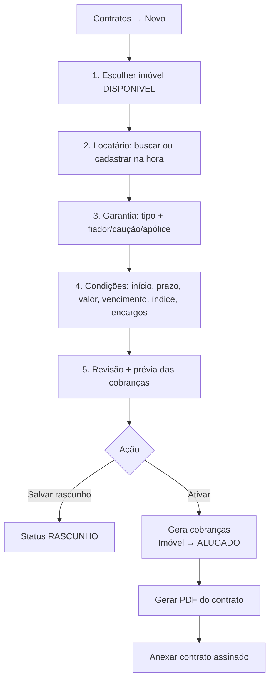

# 5. Telas e fluxos

## 5.1 Identidade visual

- **Logo**: arquivo em `PinaLogo/`. Gerar a versão SVG/PNG para `public/`, o favicon e o cabeçalho dos PDFs.
- **Cores**: extrair a paleta primária da logo e configurar como tokens (`--primary`, `--accent`) no tema do shadcn/ui. Ter tema claro e escuro.
- **Tipografia**: Inter ou Geist (via `next/font`).
- **Layout**: sidebar fixa no desktop e menu *drawer* no celular; header com busca global e menu do usuário.

## 5.2 Mapa de telas

```
/login
/                               Dashboard
/imoveis                        Lista (cards com foto de capa | tabela)
/imoveis/novo                   Formulário em etapas
/imoveis/[id]                   Detalhe com abas
/imoveis/[id]/editar
/empreendimentos                Lista + detalhe com unidades
/pessoas                        Lista (filtro por papel)
/pessoas/nova
/pessoas/[id]                   Detalhe: dados, documentos, contratos, pagamentos
/contratos                      Lista (filtro por status, vencendo)
/contratos/novo                 Wizard
/contratos/[id]                 Detalhe: resumo, cobranças, reajustes, vistorias, arquivos
/financeiro/cobrancas           Lista mensal + ação "Receber"
/financeiro/despesas            Lista + nova despesa
/manutencoes                    Kanban ou lista
/relatorios                     Receita, inadimplência, resultado por imóvel
/configuracoes                  Locador, parâmetros, modelos de contrato, categorias, usuários
```

## 5.3 Dashboard

```
┌───────────────────────────────────────────────────────────────────────┐
│  Unidades 42   Ocupadas 37 (88%)   Vagas 5   Recebido set R$ 38.400    │
│  A receber set R$ 6.200   Em atraso R$ 2.150 (3)                       │
├──────────────────────────────────┬────────────────────────────────────┤
│  Cobranças em atraso             │  Vencendo nos próximos 7 dias      │
│  • Apto 02 ADM – João – 12 dias  │  • Kitnet 5 – Maria – 20/09        │
│  • ...                  [Receber]│  • ...                             │
├──────────────────────────────────┼────────────────────────────────────┤
│  Contratos vencendo (60 dias)    │  Reajustes próximos (30 dias)      │
├──────────────────────────────────┴────────────────────────────────────┤
│  Receita x Despesa – 12 meses (gráfico de barras)                     │
└───────────────────────────────────────────────────────────────────────┘
```

## 5.4 Detalhe do imóvel

```
┌──────────────────────────────────────────────────────────────────────┐
│ ← Imóveis   Apto 02 – Ed. ADM         [ALUGADO]  [Editar] [⋯]         │
│ Rua X, 123 – Centro – Barretos/SP                                     │
├──────────────────────────────────────────────────────────────────────┤
│ [ Foto capa grande                   ] [thumb][thumb]                 │
│                                        [thumb][+8   ]                 │
├──────────────────────────────────────────────────────────────────────┤
│ Dados | Fotos | Documentos | Contratos | Financeiro | Manutenções      │
├──────────────────────────────────────────────────────────────────────┤
│ 2 quartos · 1 banheiro · 1 vaga · 55 m² · Mobiliado · Aceita pet       │
│ Aluguel R$ 1.300 · Condomínio R$ 150 · IPTU R$ 600/ano                │
│ Contrato atual: #0012 – João da Silva – até 31/03/2028   [Abrir]       │
└──────────────────────────────────────────────────────────────────────┘
```

**Aba Fotos:** área de arrastar e soltar, grade com reordenação por arraste, estrela para marcar a capa, legenda editável, lightbox em tela cheia e download.

## 5.5 Fluxos principais

### A. Cadastrar imóvel com fotos
1. Imóveis → **Novo**.
2. Etapa 1, **Identificação**: tipo, código, título, empreendimento (opcional).
3. Etapa 2, **Endereço**: digita o CEP e o sistema preenche o restante (ViaCEP).
4. Etapa 3, **Características e valores**.
5. Etapa 4, **Fotos**: upload múltiplo; a primeira foto vira a capa.
6. Salvar e ir para o detalhe.

### B. Alugar um imóvel (novo contrato)


### C. Receber aluguel
1. Financeiro → Cobranças (ou Dashboard → **Receber**).
2. O modal mostra o valor original, os dias de atraso, a multa e os juros calculados e o total.
3. O usuário informa a data, o valor recebido, a forma e, se quiser, o comprovante; pode ajustar o valor com justificativa.
4. Confirmar: cria o `Pagamento` e atualiza o status para `PAGO` ou `PAGO_PARCIAL`.
5. Botões **Baixar recibo (PDF)** e **Enviar pelo WhatsApp** (abre o `wa.me` com a mensagem e o link).

### D. Reajuste anual
1. O Dashboard alerta "Reajuste em 15 dias – Contrato #0012".
2. Abre o contrato e clica em **Aplicar reajuste**.
3. Informa o índice e o percentual acumulado dos 12 meses; o sistema mostra o novo valor.
4. Confirmar: cria o `Reajuste`, atualiza `valorAluguel` e recalcula as cobranças `PENDENTE` futuras.

### E. Encerrar ou rescindir
1. Contrato → **Encerrar**.
2. Informa a data de saída e o motivo.
3. O sistema calcula o último mês proporcional e a multa rescisória sugerida (se a saída for antecipada).
4. Mostra o resumo: cobranças futuras canceladas, saldo em aberto e devolução de caução.
5. Confirmar: o contrato passa para `ENCERRADO` ou `RESCINDIDO` e o imóvel para `DISPONIVEL` (ou `EM_REFORMA`).
6. Opcional: registrar a vistoria de saída.

## 5.6 Componentes compartilhados

| Componente | Uso |
|------------|-----|
| `DataTable` | Listas com busca, filtros, ordenação e paginação server-side |
| `MoneyInput` | Máscara `R$ 0.000,00` → Decimal |
| `CpfCnpjInput` / `PhoneInput` / `CepInput` | Máscaras e validação |
| `PessoaCombobox` / `ImovelCombobox` | Busca com autocomplete e "cadastrar novo" |
| `PhotoUploader` / `PhotoGallery` | Upload, reordenação, capa e lightbox |
| `FileList` | Lista de documentos com preview e download |
| `StatusBadge` | Cores padronizadas por status |
| `ConfirmDialog` | Confirmação de ações destrutivas |
| `EmptyState` | Telas vazias com ação principal |
